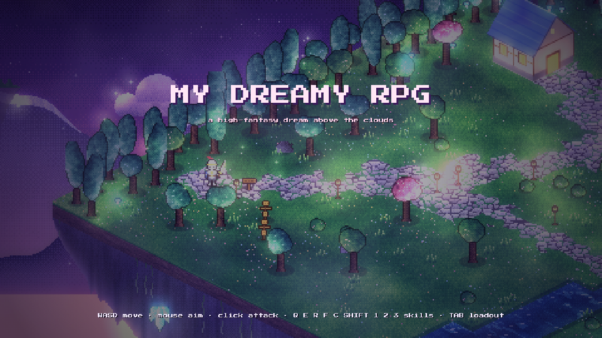
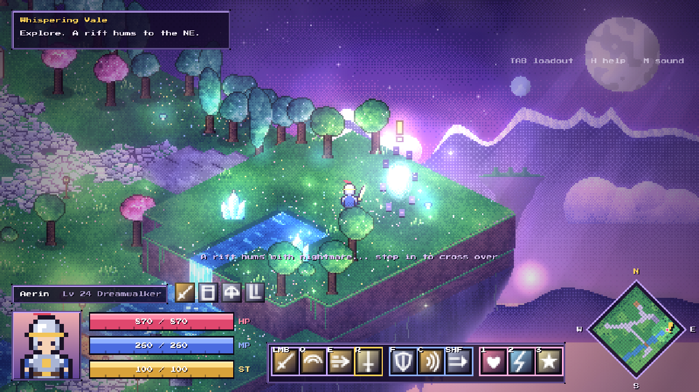
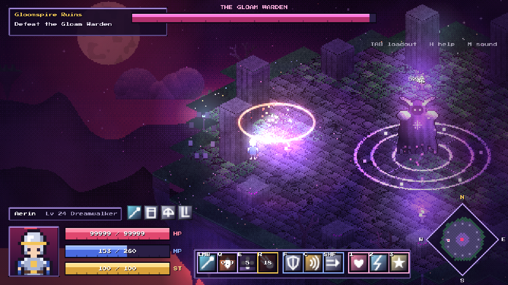
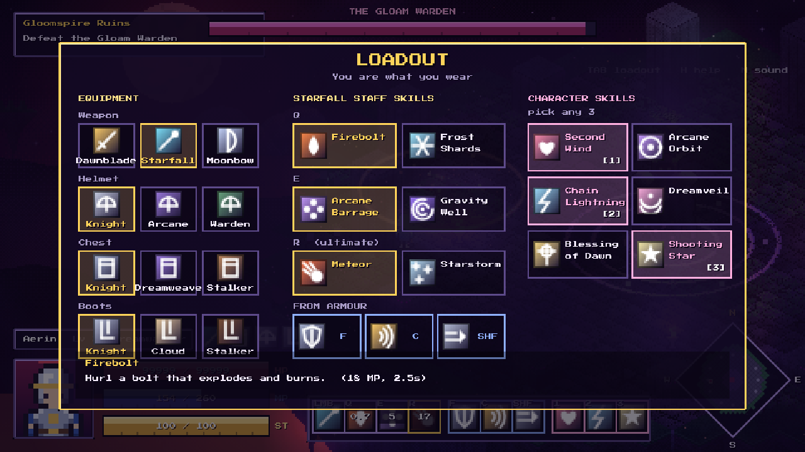

# My Dreamy RPG — concept build

A high-fantasy, dreamy pixel-art action RPG that runs in the browser, built from the hand-drawn concept sketch:
an isometric floating island (house, forests, a cliff with a waterfall feeding a river) with a HUD of a portrait,
three bars and gear icons in the bottom-left, plus a diamond compass/minimap in the bottom-right with a "!" pointing NE.

## Play

Open `index.html` in a browser (Chrome, Edge, Firefox or Safari). Nothing to build or install.
Opening the file directly works. You can also serve the folder:

```sh
python3 -m http.server 8000   # then open http://localhost:8000
```

## Controls

| Input | Action |
|---|---|
| WASD / arrows | Move |
| Mouse | Aim |
| Left click (hold) | Weapon basic attack |
| Q · E · R | Weapon skills (R is the ultimate) |
| F | Chest armour skill |
| C | Helmet skill |
| Shift / Space | Boots skill (uses stamina) |
| 1 · 2 · 3 | Character skills (your choice) |
| Tab / I | Loadout screen |
| H | Help · M toggles sound |

## Concept

* **Map 1: Whispering Vale.** A peaceful floating island with no enemies. You can explore it and try your skills on the training
  dummies. A rift glows on the plateau to the **north-east**, marked with a "!" on the compass.
* **Map 2: Gloomspire Ruins.** Stepping into the rift starts three waves of monsters (gloom slimes, ranged wisps and lunging
  shade hounds), followed by the boss, **the Gloam Warden**. The Warden telegraphs a cleave, a slam, projectile volleys and a
  charge. It enrages at 50% HP, calls adds and starts a void rain. Once it falls, a rift home opens.
* **Albion-style skills: you are what you wear.**
  * The weapon gives the basic attack plus Q/E/R. Each slot has options you pick between.
    The weapons are the Dawnblade sword, the Starfall Staff and the Moonbow.
  * The chest gives F, the helmet gives C and the boots give Shift. There are three armour sets.
  * **Character skills (1/2/3) are chosen freely** from six: Second Wind, Arcane Orbit, Chain Lightning, Dreamveil,
    Blessing of Dawn and Shooting Star.

## Tech

Plain HTML5 Canvas 2D with no dependencies, written as classic scripts so it also runs from `file://`.

* All art is **generated procedurally at load time**. This includes the tiles (world-continuous noise with ordered Bayer
  dithering), trees, the house, monsters, the boss, icons, skies, mountains, clouds and the island's rocky underside.
* The scene renders at **480×270** and is scaled up 2× with nearest-neighbour filtering. The HUD is drawn crisply at 960×540.
* Post-processing:
  * **Fake lights:** a half-resolution lightmap of radial lights is multiplied over an ambient tint, then additive halos
    are drawn on top.
  * **Bloom:** a bright-pass made by cubing the colours through self-multiplication, at ¼ and ⅛ resolution, added back
    with `lighter`.
  * **Fog and mist:** tileable noise layers drifting with parallax, waterfall spray and chimney smoke.
  * God rays, a colour grade and a vignette.

| File | Contents |
|---|---|
| `js/util.js` | Noise, dithering, pixel buffers, iso projection |
| `js/art.js` | Procedural sprites |
| `js/maps.js` | Map building, ground rasteriser, cliffs and underside |
| `js/data.js` | Gear roster and skills |
| `js/game.js` | Player, combat, enemies, boss, waves, audio |
| `js/render.js` | Scene and post-processing |
| `js/hud.js` | HUD, loadout screen and minimap |
| `js/main.js` | Main loop, input and transitions |

Showcase URL parameters: `?scene=play`, `?scene=arena`, `?scene=boss`, `?scene=loadout`, `?scene=portal`, `&weapon=starfall|moonbow`.

## Screenshots





